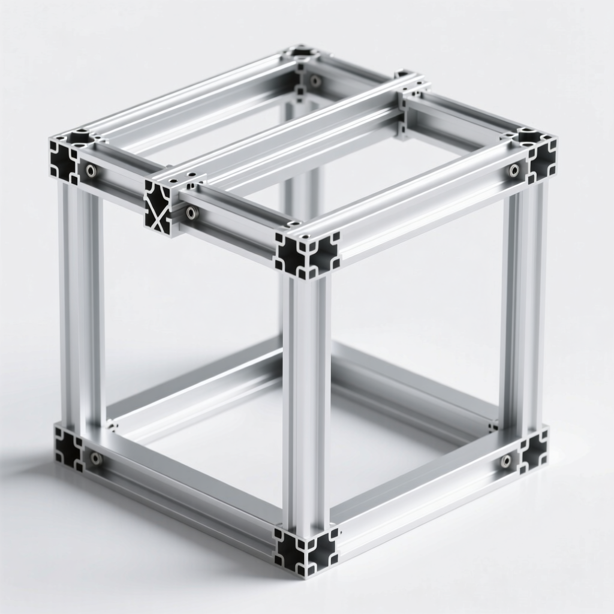
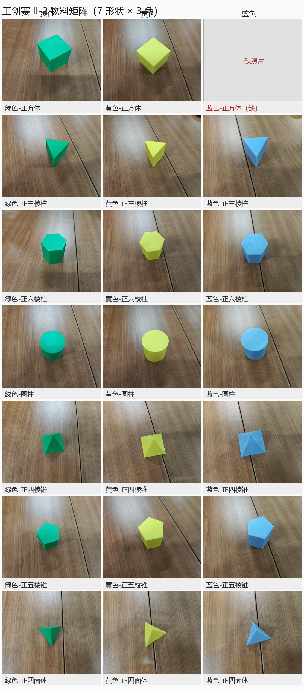
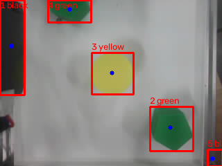
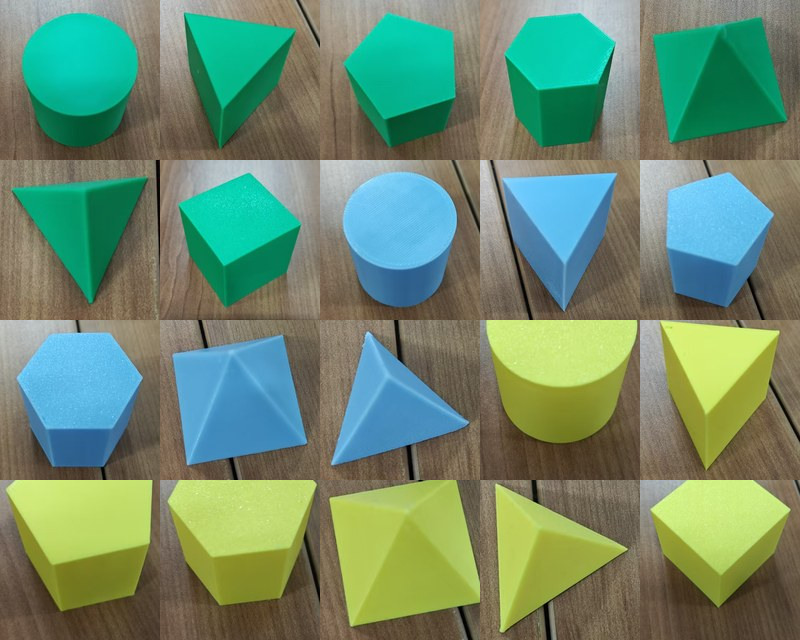
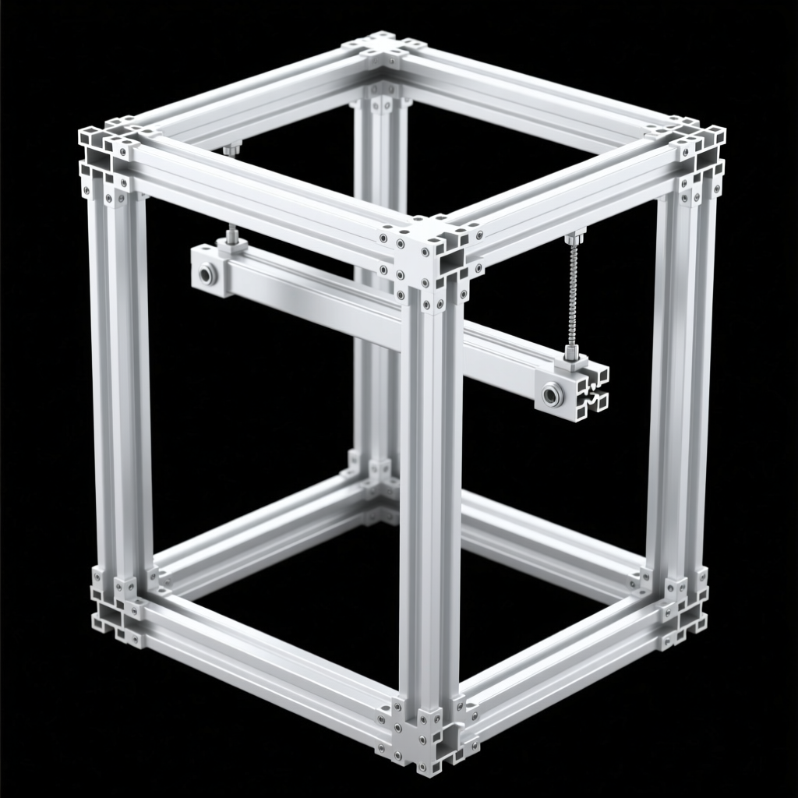

# 工创赛 II-2 · 智能分拣装置

> **2026 年四川省大学生工程实践与创新能力大赛 · 项目 II-2「智能分拣」**
> 龙门式两轴 + 舵机 Z 轴 + 平行夹爪 ｜ K210 相机（PC 端识别）｜ STM32F103C8T6 运动控制 ｜ TJC 串口屏逐件显示

<p align="center">
  
</p>

## 这是什么

一台在 **350 × 350 × 450 mm** 内完成物料自动分拣的装置：料盘上 ≥12 件、≥6 种（颜色 × 形状）物料，
**逐件**识别 → 抓取 → 按「同形同色」分入 6 个储物盒（单盒 ≤4 件），每件分拣前在屏上显示其名称/图片/序号。

| 项目 | 内容 |
|---|---|
| 机构 | 龙门 X/Y 同步带 + 光轴导轨；Z 轴舵机 + 平行四边形连杆；平行两指夹爪（双齿条自定心） |
| 主控 | STM32F103**C8T6**（48 pin，64 KB Flash / 20 KB RAM），**固件 v0.8.2** |
| 执行器 | X/Y：2 × ZDT **X42 V1.3** 闭环步进（脉冲模式，细分 16，80 步/mm）<br>Z 轴 / 夹爪：MG996R 舵机（无位置反馈，只能靠固定延时） |
| 视觉 | K210（CanMV）**只当相机** → 照片回传 PC → OpenCV HSV 识别 → 像素→毫米 → 抓取坐标 |
| 交互 | TJC 3.5″ 串口屏（480×320）：物料名称 + 图片 + 序号 + 计数 |
| 许可 | 代码 [MIT](LICENSE)；第三方素材见 [THIRD_PARTY_NOTICES.md](THIRD_PARTY_NOTICES.md) |

## 效果与实物

| 物料实物（7 形状 × 3 颜色，共 21 种）| 视觉识别标注 |
|---|---|
|  |  |

| 屏端成品 UI | 框架结构参考 |
|---|---|
|  |  |

## 系统架构

```
        K210 摄像头（CanMV）                        STM32F103C8T6
        ┌──────────────┐   USB 串口          ┌────────────────────────────┐
        │  只负责拍照   │ ───────────────▶ PC │ USART1  PA9/PA10  115200 8E1│
        └──────────────┘      (115200 8N1)   │   ├─ X 步进  PA0/PA1/PA4    │
                                             │   ├─ Y 步进  PA12/PA6/PA7  │
   PC 端（Python + OpenCV）                   │   ├─ Z 舵机  PB0 (TIM3_CH3) │
   ① HSV 找颜色 ② 形状判据（对称阶数/椭圆残差）│   ├─ 夹爪    PB1 (TIM3_CH4) │
   ③ 像素→龙门 mm（比例+旋转+锚点）           │   ├─ 串口屏  USART2 PA2/PA3 │
   ④ 调 pick_place 执行 8 步抓放               │   ├─ 红外×6  PB12~15/PA8/PA11│
                                             │   └─ K210 直连(预留) USART3 │
                                             └────────────────────────────┘
```

**分工原则**：一切安全判断（未对零禁动、软限位、急停）都在**固件**里；PC 只发指令、不做兜底。

## 目录导航

| 目录 | 内容 | 从哪看起 |
|---|---|---|
| [`docs/`](docs/) | 面向外部读者的说明（目录说明 / 快速开始 / 常见问题） | [docs/00_目录说明.md](docs/00_目录说明.md) |
| [`01_规则与命题/`](01_规则与命题/) | 官方规则 PDF、规则要点提取、物料图鉴 | [II-2规则要点](01_规则与命题/II-2规则要点与搬运赛道对照.md) |
| [`02_方案与说明书/`](02_方案与说明书/) | 总体方案、参赛说明书、阶段成果汇报 | [校选方案说明书](02_方案与说明书/校选方案说明书.md) |
| [`03_设计与尺寸/`](03_设计与尺寸/) | 夹爪设计参数、框架与布局尺寸 | [夹爪设计参数表](03_设计与尺寸/夹爪设计参数表.md) |
| [`04_采购/`](04_采购/) | 采购清单、选型问答（含取舍理由） | [采购清单](04_采购/采购清单.md) |
| [`05_工具与校核/`](05_工具与校核/) | 布局校核、物料分析、STL/文档转换小工具 | — |
| [`06_参考与开源/`](06_参考与开源/) | 参考项目与开源夹爪资料（第三方，附来源与许可） | [来源与许可](06_参考与开源/开源夹爪打印包_20260917/06_来源与许可.md) |
| [`07_概念图/`](07_概念图/) | 框架结构概念图 | — |
| [`08_视觉/`](08_视觉/) | **视觉链路**：`vision/`（识别+抓取）、`omv/`（K210 端）、拍照/REPL 工具 | [vision_pick.py](08_视觉/vision/vision_pick.py) |
| [`09_固件/`](09_固件/) | **STM32 固件**：`src/` C 源码、`keil/` 工程、`build.py`、烧录脚本、接线总表 | [接线总表](09_固件/接线总表-C8T6-20261004.md) |
| [`10_屏幕图片/`](10_屏幕图片/) | 串口屏工具、控件表、图片 ID 对照、屏内资源 | [屏端UI控件表](10_屏幕图片/屏端UI控件表.md) |
| [`11_ESP无线调试/`](11_ESP无线调试/) | ESP32-C3/C6 无线链路（**已停用**，留档） | [说明](11_ESP无线调试/说明.md) |
| [`hw_bridge/`](hw_bridge/) | **PC ↔ STM32 桥**：`server.py`、`tools/`（手动控制/抓放/探针） | [protocol.md](hw_bridge/protocol.md) |
| [`models/`](models/) | **3D 模型**（夹爪 3 套方案、龙门架、置物架、滑梯等）| [models/README.md](models/README.md) |
| [`工创赛物料/`](工创赛物料/) | 21 种物料实物照片（识别用真值） | — |

> 仓库里**不含**第三方 Python 库（原 `hw_bridge/vendor*`，约 1260 个文件），
> 改用 [`hw_bridge/requirements.txt`](hw_bridge/requirements.txt) 安装。

## 五分钟上手

```bash
# 0) 装依赖（Python 3.8+）
pip install -r hw_bridge/requirements.txt

# 1) 找板子和相机的串口号（口号会变，脚本已自动认，但先跑一下心里有数）
python hw_bridge/tools/port_probe.py --list

# 2) 手动控制台：w/s = Z 升降，a/d = 夹爪，j/l/i/k = X/Y，p = 状态，x = 退出
python hw_bridge/tools/manual_pick.py

# 3) 视觉引导抓一件（拍照 → 识别 → 坐标 → 抓取 → 放置）
python 08_视觉/vision/vision_pick.py --color yellow --dry      # 先空跑，只看坐标
python 08_视觉/vision/vision_pick.py --color yellow --drop     # 确认后真抓
```

固件：`python 09_固件/build.py` 编译（Keil armclang），`09_固件/flash_keil.ps1` 经 ST-Link 烧录。
完整步骤（含凭据/依赖/常见报错）见 **[docs/01_快速开始.md](docs/01_快速开始.md)**。

## 值得一看的工程细节

这些是真正花时间啃出来的，写在这里方便别人直接借鉴：

1. **一个定时器做两轴不同速的软步进**：X/Y 脉冲不像常规做法占用同一路定时器通道，而是用 **TIM4 10 kHz 中断 + 两轴独立 Q16 相位累加**，顺带解决两轴联动插补；只在运动时开定时器，停了两轴自动关。
2. **F103 的一个坑**：`PSC=0 + ARR=0` 想"每次计数都溢出"在这片芯片上**不会产生溢出中断**，必须写 `PSC=0 + ARR=时钟/频率-1`（详见 [`09_固件/src/board.c`](09_固件/src/board.c) 注释）。
3. **闭环步进驱动器的两种接口**：X42 既能吃脉冲也能吃串口；实物排针只有 `V G Com En Stp Dir`（**没有** `Stp−/Dir−/En−`），共阴接法靠 `Com → GND` 这一根，漏接则三路光耦全不导通。
4. **视觉标定的最小充分集**：两点只用于解**比例 + 旋转**；平移只需**一个锚点**（某件货的像素中心 ↔ 它当时的龙门 mm）。相机装在龙门上 ⇒ 映射是"相对当前夹爪位置"的，**换原点不用重标**，但 **Z 高度会改变比例**。
5. **形状判据别看顶点数**：`approxPolyDP` 数顶点在真实光照下会在 `hexagon / poly7x / circle / square-ish` 之间跳变。改用**角向对称阶数**（对凸包的射线-边求交半径做 FFT）+ **椭圆残差**，才把"俯视正多边形"和"斜视圆柱"分开。
6. **开环系统必须有核验**：舵机无反馈、步进开环 ⇒ 脚本能报告"8 步都执行了"，但**不代表夹住了货**。本项目靠"动作后复拍一张"发现过两次"抓空/推走"。见 [docs/02_常见问题.md](docs/02_常见问题.md)。
7. **串口会骗人**：CH340 的 DTR/RTS 接了复位 ⇒ **一开串口板子就复位**（位置归零、EN 失能），所以长流程必须"开一次口、发完整序列"；USB 口号也会漂（本项目调试期从 COM5/COM14 漂到 COM15/COM11）。

## 当前进度与已知问题

- ✅ 龙门 X/Y 步进 + Z/夹爪舵机运动控制（软步进 10 kHz，18 种错误码 + 安全门禁）
- ✅ 串口协议 / 串口屏显示 / 6 路红外驱动（红外未做遮挡验证）
- ✅ **单件"视觉引导抓取 → 放置"全流程跑通**（8 步流程，含自由落料）
- ✅ Y 轴脉冲脚由 PA5 改到 PA12（PA5 引脚实测损坏，固件 v0.8.2）
- ✅ 形状判据重写（角向对称阶数 + 椭圆残差）
- ⏳ 形状识别在真实光照/塑料反光下仍会偶发跳变 → 相机俯角下的**仿射白化**修复进行中
- ⏳ 多盒分配策略（一盒一类、单盒 ≤4）、储物盒安装
- ⏳ 整机 ≥12 件连续分拣 + 屏端逐件显示串联
- ⏳ K210 ↔ STM32 直连（USART3 已预留）

## 安全须知（重要）

1. **"安全位置" = 放置点正上方 + Z 最高**，它同时是 **+X 机械极限** —— 任何指令的 X 都不得为正（脚本内强制拒绝，除非显式 `--allow-plusx`）。
2. 每次抓放以 `ZERO all` 起（以启动时夹爪位置为原点），结束必须 **Z 升到最高、原地停住**，不做多余 XY 移动。
3. Z 舵机越接近 611 µs 越贴内部止挡，**听到持续嗡嗡就回退 20~30 µs**（本项目烧过一颗舵机）。
4. 急停 = 直接断电；任何异响/顶死立即断电检查。

## 许可与致谢

- 本项目自有代码与文档：[MIT](LICENSE)。
- 参考/引用到的第三方开源项目（SO-ARM 夹爪、开源夹爪打印包、SSG48 等）**各自遵循其原作者许可**，清单见 [THIRD_PARTY_NOTICES.md](THIRD_PARTY_NOTICES.md)。
- 版本里程碑见 [CHANGELOG.md](CHANGELOG.md)。
